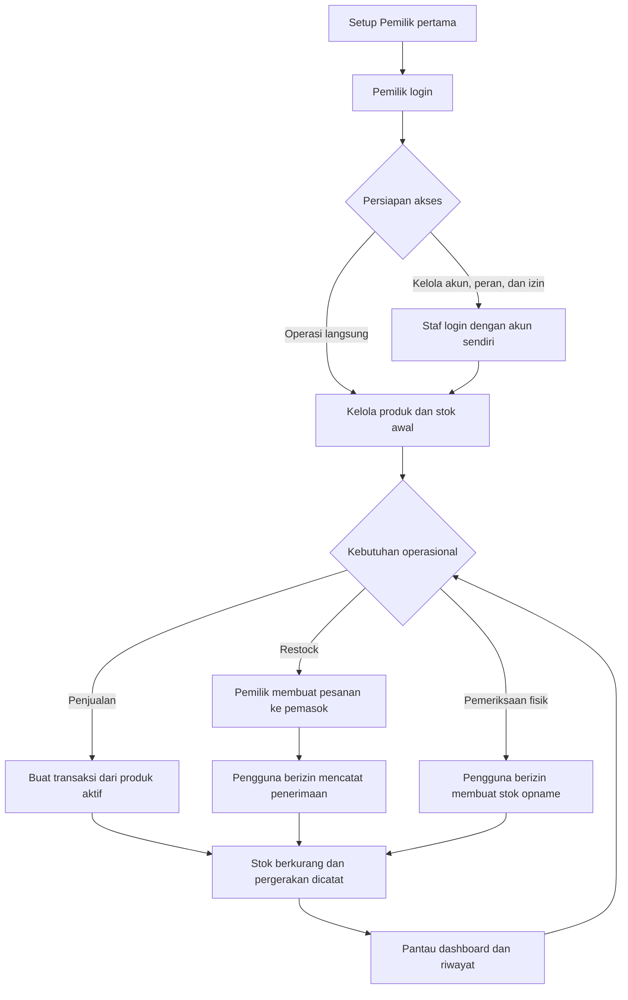

# Warung Madura Stock Manager

> Aplikasi web untuk membantu pengelolaan produk, stok, penjualan, penerimaan barang, dan akses pengguna pada satu toko Warung Madura.

<p align="center">
  <strong>Dokumentasi proyek · Bahasa Indonesia</strong><br />
  React · TypeScript · Express · PostgreSQL · Prisma
</p>

---

## Daftar isi

- [Ringkasan proyek](#ringkasan-proyek)
- [Latar belakang dan tujuan](#latar-belakang-dan-tujuan)
- [Ruang lingkup](#ruang-lingkup)
- [Fitur utama](#fitur-utama)
- [Workflow sistem](#workflow-sistem)
- [Peran dan keamanan](#peran-dan-keamanan)
- [Arsitektur dan status data](#arsitektur-dan-status-data)
- [Teknologi](#teknologi)
- [Persyaratan](#persyaratan)
- [Instalasi dan menjalankan aplikasi](#instalasi-dan-menjalankan-aplikasi)
- [Perintah proyek](#perintah-proyek)
- [Struktur repository](#struktur-repository)
- [Verifikasi dan batasan](#verifikasi-dan-batasan)
- [Dokumentasi](#dokumentasi)

## Ringkasan proyek

Warung Madura Stock Manager adalah aplikasi web full-stack untuk mendukung alur operasional dasar toko: memantau produk dan stok, mencatat penjualan, mengelola pemasok dan restock, melakukan stok opname, serta mengatur akun dan hak akses. Aplikasi terdiri dari frontend React dan REST API Express. Autentikasi menggunakan username dan PIN; otorisasi diterapkan pada API dengan role-based access control (RBAC) serta izin khusus pengguna.

Proyek ini juga berfungsi sebagai sandbox pembelajaran rekayasa perangkat lunak. **Status persistensi perlu diperhatikan:** autentikasi dan administrasi akses menggunakan PostgreSQL melalui Prisma, sedangkan layanan data operasional yang dipakai UI saat ini menggunakan `MockDataStore` di memori proses. Data bisnis dapat kembali ke data awal setelah server dimulai ulang dan belum diisolasi per toko.

## Latar belakang dan tujuan

Operasional toko membutuhkan pencatatan barang, perubahan stok, transaksi, dan pembagian tanggung jawab antar pengguna. Aplikasi ini menyatukan alur tersebut dalam antarmuka web dan menyediakan kontrol akses agar pengguna hanya dapat memakai fungsi yang diberikan.

Tujuan implementasi:

1. Menyediakan alur dasar pengelolaan produk, penjualan, restock, dan stok opname.
2. Mendukung akun Pemilik dan Staf dengan hak akses yang dapat dikendalikan.
3. Melindungi kredensial, sesi, data harga modal, dan identitas pelaksana melalui pemeriksaan di sisi server.
4. Menyediakan dokumentasi teknis, operasional, dan keamanan yang dapat ditelusuri.

## Ruang lingkup

**Termasuk:** setup Pemilik pertama; login/logout; pengelolaan akun, PIN, peran dan izin; quick switch Pemilik; dashboard; produk; penjualan; pemasok; pesanan dan penerimaan restock; pergerakan stok; serta stok opname.

**Belum menjadi kemampuan produksi:** penyimpanan persisten untuk seluruh data bisnis, pemisahan tenant/cabang, pemulihan PIN mandiri, dan infrastruktur produksi seperti deployment pipeline, backup teruji, observability, serta pengelolaan rahasia. Rincian risiko dan rekomendasi ada di [Laporan Proyek](docs/PROJECT_REPORT.md).

## Fitur utama

| Area | Kemampuan |
|---|---|
| Autentikasi | Setup Pemilik pertama, login/logout dengan username dan PIN, sesi per login, serta pembatasan percobaan login |
| Akses pengguna | Membuat atau menonaktifkan akun, reset PIN, menetapkan peran, preset peran, dan izin khusus per pengguna |
| Quick switch | Pemilik dapat melihat aplikasi dengan identitas dan izin akun Staf, lalu kembali; peristiwa switch dicatat sebagai audit |
| Produk dan stok | Pencarian produk, pengelolaan data sesuai izin, status aktif/nonaktif, penyesuaian, dan riwayat pergerakan stok |
| Penjualan | Pencatatan transaksi dari produk aktif yang tersedia, riwayat, detail, dan pembatasan akses transaksi milik sendiri |
| Restock | Data pemasok, pesanan restock, penerimaan barang, serta pencatatan barang baik/rusak/bonus sesuai izin |
| Stok opname | Riwayat dan pencatatan hasil pemeriksaan fisik sesuai izin |
| Perlindungan data | Default-deny pada izin, harga modal hanya untuk Pemilik, dan identitas pelaksana ditetapkan dari sesi server |

Rincian alur pengguna tersedia di [Panduan Pengguna](docs/USER_GUIDE.md); cakupan izin dijabarkan dalam [Matriks Izin](PERMISSIONS.md).
## Workflow sistem

Alur berikut menunjukkan hubungan antarproses utama dari persiapan akun hingga pengawasan stok. Setiap tindakan operasional tetap mengikuti izin akun yang sedang aktif.



### Tahapan alur

1. **Inisialisasi akses.** Pemilik pertama dibuat melalui halaman setup. Pemilik kemudian membuat akun, menetapkan peran, dan menyesuaikan izin sesuai tanggung jawab.
2. **Persiapan katalog.** Pengguna dengan izin yang sesuai meninjau produk dan ketersediaan stok. Pengelolaan harga modal tetap khusus Pemilik.
3. **Operasi harian.** Pengguna mencatat penjualan dari produk aktif dan tersedia. Sistem mengaitkan transaksi dengan identitas sesi; riwayat yang terlihat mengikuti izin pengguna.
4. **Pengadaan dan penerimaan.** Pemilik membuat pesanan restock, lalu pengguna yang memiliki izin penerimaan mencatat barang diterima, rusak, atau bonus. Identitas penerima berasal dari sesi.
5. **Rekonsiliasi stok.** Pengguna yang berwenang melakukan opname atau penyesuaian. Pergerakan stok dan riwayat digunakan untuk meninjau perubahan.
6. **Pemantauan dan kontrol akses.** Dashboard dan riwayat membantu meninjau kondisi operasional. Pemilik dapat mengubah akses atau memakai quick switch untuk memeriksa pengalaman akun Staf.

> **Catatan implementasi:** diagram menjelaskan alur fitur aplikasi, bukan jaminan persistensi data. Saat ini data bisnis yang digunakan UI/API tersimpan di `MockDataStore` in-memory; data tersebut tidak tahan restart. Detail status data ada di [Arsitektur & Model Data](docs/ARCHITECTURE.md) dan [Laporan Proyek](docs/PROJECT_REPORT.md#batasan-dan-risiko).

## Peran dan keamanan

Pemilik menyiapkan pengguna dan mengelola preset atau izin individual. Staf masuk menggunakan akun masing-masing. Izin diperiksa pada server; penyembunyian menu di frontend hanya membantu tampilan dan bukan batas keamanan.

PIN disimpan dalam bentuk hash scrypt. Token sesi acak disimpan sebagai hash, sementara cookie sesi menggunakan `HttpOnly`, `SameSite=Strict`, masa berlaku terbatas, dan `Secure` saat `NODE_ENV=production`. Respons untuk selain Pemilik menyaring `purchasePrice`; identitas penerima atau pemeriksa berasal dari sesi terverifikasi. Quick switch menggunakan izin pengguna target dan tidak memberikan hak Pemilik selama mode tersebut.

Untuk detail kontrol, cakupan endpoint, dan batas implementasi, lihat [Audit Guard](GUARD.md), [Matriks Izin](PERMISSIONS.md), [Arsitektur](docs/ARCHITECTURE.md), dan [Referensi API](docs/API.md).

## Arsitektur dan status data

```text
Browser (React SPA :5173)
        │ /api — proxy Vite saat development
        ▼
Express REST API (:4000)
        │
        ├── Auth, akun, role, sesi, audit ── Prisma ── PostgreSQL
        └── Layanan operasional bisnis ──── MockDataStore (memori proses)
```

Vite proxy hanya dipakai dalam development. Build produksi perlu routing API/reverse proxy yang dikonfigurasi oleh deployment. Perbedaan antara skema bisnis Prisma dan data runtime mock juga penting: skema database mendeskripsikan entitas bisnis, tetapi UI/API operasional saat ini belum memakai skema tersebut sebagai penyimpanan persisten.

Lihat [Arsitektur & Model Data](docs/ARCHITECTURE.md) untuk struktur komponen dan alur request.

## Teknologi

| Lapisan | Teknologi |
|---|---|
| Frontend | React 19, TypeScript, Vite 7, React Router 7, Tailwind CSS 4 |
| API | Node.js, Express 5, TypeScript, Zod |
| Database dan ORM | PostgreSQL 15+, Prisma 6 |
| Tooling | npm workspaces, ESLint, tsx, concurrently |

## Persyaratan

- Node.js **20.19 atau lebih baru** dan npm.
- PostgreSQL **15 atau lebih baru**, berjalan lokal atau dapat diakses server.
- Git untuk mengambil repository.

## Instalasi dan menjalankan aplikasi

1. Buat database PostgreSQL bernama `warung_madura`.
2. Buat `server/.env` dengan konfigurasi lokal berikut. Isi kredensial yang sesuai dan jangan commit file `.env`.

   ```env
   DATABASE_URL="postgresql://postgres:<PASSWORD_URL_ENCODED>@localhost:5432/warung_madura?schema=public"
   PORT=4000
   ```

   Jika password berisi karakter khusus, URL-encode bagian password.
3. Dari direktori repository ini, jalankan:

   ```bash
   npm install
   npm run db:generate
   npm run db:migrate
   npm run dev
   ```
4. Buka `http://localhost:5173` dan buat Pemilik pertama melalui halaman setup.

Perintah migrasi `db:migrate` menerapkan migrasi yang tersedia; untuk membuat migrasi saat pengembangan gunakan `npm run db:migrate:dev`. Instruksi Windows, seed/reset, konfigurasi, dan troubleshooting terdapat di [Panduan Pengembangan](docs/DEVELOPMENT.md).

## Perintah proyek

Jalankan dari root repository:

| Perintah | Kegunaan |
|---|---|
| `npm run dev` | Menjalankan API dan frontend dalam mode development |
| `npm run build` | Build server dan client |
| `npm run lint` | Menjalankan ESLint pada repository |
| `npm run typecheck` | Memeriksa tipe server dan client |
| `npm run test:auth` | Menjalankan tes unit modul autentikasi/izin |
| `npm run db:generate` | Membuat Prisma Client |
| `npm run db:migrate` | Menerapkan migrasi yang tersedia |
| `npm run db:migrate:dev` | Membuat/menerapkan migrasi development |
| `npm run db:seed` | Menjalankan seed database |
| `npm run db:reset` | Reset database development dan menjalankan seed |

Periksa [Panduan Pengembangan](docs/DEVELOPMENT.md) sebelum menjalankan reset karena perintah tersebut menghapus data database target.

## Struktur repository

```text
.
├── client/                 # SPA React, halaman, komponen, dan API client
├── server/
│   ├── prisma/              # Skema, migrasi, dan seed Prisma
│   └── src/                 # Express app, routes, services, middleware, validators
├── docs/                    # Laporan dan dokumentasi teknis/pengguna
├── GUARD.md                 # Inventaris guard endpoint dan audit kontrol
├── PERMISSIONS.md           # Matriks izin dan batas akses data
└── README.md                # Ikhtisar proyek dan indeks dokumentasi
```

## Starter lab awal

File starter lab yang sebelumnya berada di root kini dipertahankan di [`lab-starter/`](lab-starter/README.md), terpisah dari aplikasi Warung Madura. Folder tersebut memuat `server.js`, Dockerfile, konfigurasi contoh, package files, README, dan workflow starter.

Workflow di dalam `lab-starter/.github/` tidak dijalankan otomatis oleh GitHub Actions karena GitHub hanya memuat workflow dari `.github/workflows/` di root repository. File tersebut dipertahankan sebagai bagian dari starter lab.

## Verifikasi dan batasan

Repository menyediakan pemeriksaan lint, type-check, build, dan unit test autentikasi. Keberadaan script tidak berarti semua sudah dijalankan pada perubahan terbaru; lihat laporan hasil dan cakupan verifikasi di [Laporan Proyek](docs/PROJECT_REPORT.md#verifikasi). Tes unit yang tersedia belum menggantikan pengujian integrasi API, browser end-to-end, beban, atau pemulihan database.

Keterbatasan utama saat ini:

- Data operasional bisnis masih in-memory, tidak tahan restart, dan dibagi pada proses server.
- Belum ada isolasi tenant/toko atau cabang.
- Pembatasan login in-memory; audit quick switch belum memiliki UI dan kebijakan retensi.
- Pengujian belum mencakup semua alur API dan UI.

Jangan mengandalkan versi ini sebagai pencatatan produksi tanpa migrasi penyimpanan bisnis dan penguatan operasional. Rencana tindak lanjut dijelaskan di [Laporan Proyek](docs/PROJECT_REPORT.md#rekomendasi-lanjutan).

## Dokumentasi

Dokumentasi lengkap berada di repository yang sama. Buka topik yang diperlukan agar README tetap mudah dipindai.

| Dokumen | Isi |
|---|---|
| [Laporan Proyek](docs/PROJECT_REPORT.md) | Latar belakang, tujuan, ruang lingkup, kebutuhan, desain, verifikasi, risiko, dan rekomendasi |
| [Panduan Pengguna](docs/USER_GUIDE.md) | Setup, login, pengelolaan akun, quick switch, dan alur operasional |
| [Arsitektur & Model Data](docs/ARCHITECTURE.md) | Komponen, alur request, autentikasi, data, dan persistensi |
| [Referensi API](docs/API.md) | Endpoint, autentikasi, validasi, izin, dan format error |
| [Panduan Pengembangan](docs/DEVELOPMENT.md) | Instalasi rinci, migrasi, seed, perintah, dan troubleshooting |
| [Audit Guard](GUARD.md) | Inventaris endpoint, kontrol aktif, dan status audit guard |
| [Matriks Izin](PERMISSIONS.md) | Peran, izin, akses transaksi, dan perlindungan data sensitif |

---

<p align="center">Warung Madura Stock Manager · dokumentasi mengikuti implementasi repository saat ini</p>
