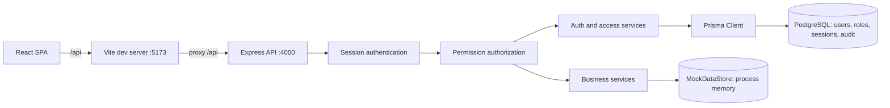

# Arsitektur dan Model Data

## Konteks sistem

Ketika production build dipakai, Vite bukan API gateway runtime. Konfigurasi proxy di `client/vite.config.ts` berlaku untuk development; deployment harus mengatur routing reverse proxy sendiri.

## Struktur komponen

### Client

- `client/src/App.tsx`: routing halaman, auth gate, izin tampilan, dan redirect.
- `client/src/contexts/AuthContext.tsx`: sesi pengguna, login/logout, quick switch, dan pemeriksaan izin UI.
- `client/src/api/`: wrapper request API.
- `client/src/pages/`: halaman dashboard, produk, penjualan, restock, opname, login/setup, dan akses.
- `client/src/components/Layout.tsx`: navigasi sesuai izin, identitas sesi, quick switch, indikator mode, dan kembali ke Pemilik.

Pemeriksaan izin di UI memberi pengalaman navigasi yang sesuai; otorisasi yang dipercaya tetap dilakukan API.

### Server

- `server/src/index.ts`: konfigurasi dan listen HTTP.
- `server/src/app.ts`: urutan middleware dan pemasangan route.
- `server/src/routes/`: HTTP interface per domain.
- `server/src/validators/`: parsing input dengan Zod.
- `server/src/services/`: aturan bisnis.
- `server/src/middleware/authenticate.ts`: pembacaan sesi dan RBAC default-deny.
- `server/src/lib/auth.ts`: hash PIN, token sesi, cookie, dan proyeksi user efektif.
- `server/src/lib/permissions.ts`: katalog permission dan aturan endpoint.
- `server/src/lib/mock-store.ts`: sumber data bisnis sementara in-memory.

## Alur request dan autentikasi

1. Browser mengirim request `/api`; saat development Vite mem-proxy ke Express.
2. Request JSON dibatasi ukuran body-nya; route login/setup meminta header `X-App-Request: 1`.
3. Untuk endpoint terlindungi, middleware membaca cookie `warung_session`, menghitung hash token, lalu memuat sesi aktif beserta pengguna.
4. Bila sesi sedang quick switch, pengguna efektif adalah `actingAsUser`; middleware memeriksa status aktifnya. Bila target telah dinonaktifkan, audit `FORCED_RETURN` dibuat dan sesi kembali ke Pemilik.
5. Middleware mencocokkan method/path ke aturan permission. Rute yang tidak dikenal tidak mendapat aturan bisnis implisit; API menutup route yang tidak cocok dengan 404.
6. Input divalidasi dengan Zod, service dijalankan, dan response dikirim. Response non-Pemilik menjalani redaksi rekursif `purchasePrice`.

### Sesi

- Masa berlaku sesi: 8 jam.
- Cookie `HttpOnly`, `SameSite=Strict`, `Path=/api`; `Secure` aktif di production.
- Database menyimpan SHA-256 token, bukan token cookie mentah.
- Tiap login membentuk sesi tersendiri. Tab/browser profile yang sama tetap berbagi cookie.

### Quick switch

`AuthSession.userId` tetap menunjuk akun Pemilik; `actingAsUserId` menunjuk akun target. Hal ini mempertahankan otoritas Pemilik untuk mengakhiri impersonasi, tanpa memberi izin Pemilik pada operasi target. Target harus akun non-Pemilik aktif.

API menghitung izin dan display identity dari pengguna efektif. Kembali menghapus `actingAsUserId`. Mulai/kembali/keluar ketika switch aktif ditulis ke `AuthSwitchAudit`; jika target dinonaktifkan, middleware kembali ke Pemilik dan mencatat `FORCED_RETURN`.

## Model data dan persistensi

### PostgreSQL melalui Prisma

| Model | Kegunaan |
|---|---|
| `User` | Username, nama tampilan, hash PIN, role, status, izin individual atau mode mengikuti role |
| `AccessRole` | Nama role, permission preset, penanda role sistem |
| `AuthSession` | Hash token, pemilik sesi, target quick switch opsional, masa berlaku |
| `AuthSwitchAudit` | Pemilik, target, aksi switch, timestamp |
| Model bisnis | Produk, supplier, sale/item, stock movement, restock/order/receipt, inventory check/item |

Model bisnis disertakan dalam schema/migrations dan seed. Namun, API bisnis saat ini membaca/menulis `MockDataStore`; model bisnis PostgreSQL tersebut **belum menjadi sumber runtime untuk layanan bisnis**.

### MockDataStore

Store diinisialisasi dalam proses server dan dibagikan pada semua akun yang masuk ke proses tersebut. Data akan kembali ke state awal ketika server dimulai ulang. Login akun terpisah tidak membuat salinan toko dan tidak memberi isolasi data.

## Keputusan dan trade-off

- **PIN + sesi cookie:** sederhana untuk aplikasi lokal; butuh TLS dan penguatan operasional untuk deployment.
- **Role preset + izin per akun:** mendukung kebijakan umum sekaligus pengecualian per pengguna. Perubahan permission mencabut sesi target agar izin baru dimuat pada login selanjutnya.
- **Quick switch tanpa PIN target:** memudahkan Pemilik mengecek akun, tetapi merupakan impersonasi berprivilege. Karena itu tersedia hanya dari sesi Pemilik dan operasi dijalankan dengan izin target.
- **Mock store bisnis:** mempertahankan sandbox yang ada, tetapi mencegah klaim persistensi dan kesiapan produksi.

## Jalur kode utama

- [Server app](../server/src/app.ts)
- [Authentication middleware](../server/src/middleware/authenticate.ts)
- [Auth service](../server/src/services/auth.service.ts)
- [Permission catalog](../server/src/lib/permissions.ts)
- [Prisma schema](../server/prisma/schema.prisma)
- [MockDataStore](../server/src/lib/mock-store.ts)
- [Client routing](../client/src/App.tsx)
- [Auth context](../client/src/contexts/AuthContext.tsx)
- [Quick switch UI](../client/src/components/Layout.tsx)
