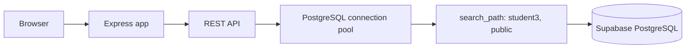

# DevSprint Lab Starter - Student 3

Starter lab ini dipertahankan sebagai referensi terpisah dari aplikasi Warung Madura di folder `lab-starter`. Jalankan perintah lab dari folder `lab-starter`.

Aplikasi demo untuk mempelajari layanan Node.js/Express yang terhubung ke PostgreSQL Supabase. Setiap peserta bekerja pada branch dan schema database masing-masing. README ini menjelaskan konfigurasi khusus **Student 3**.

> **Status proyek:** aplikasi ini adalah lab pembelajaran, bukan layanan produksi. API Notes saat ini belum memakai autentikasi. Jangan menyimpan data sensitif.

## Daftar isi

- [Ringkasan](#ringkasan)
- [Pembagian Student 3](#pembagian-student-3)
- [Fitur dan alur aplikasi](#fitur-dan-alur-aplikasi)
- [Arsitektur](#arsitektur)
- [Isolasi schema PostgreSQL](#isolasi-schema-postgresql)
- [Teknologi](#teknologi)
- [Persiapan lokal](#persiapan-lokal)
- [Menjalankan dan memeriksa aplikasi](#menjalankan-dan-memeriksa-aplikasi)
- [Referensi API](#referensi-api)
- [Build, CI, dan deployment](#build-ci-dan-deployment)
- [Keamanan dan batasan](#keamanan-dan-batasan)
- [Struktur repository](#struktur-repository)
- [Pemecahan masalah](#pemecahan-masalah)

## Ringkasan

DevSprint adalah lab container multi-tenant berbasis Google Cloud Platform dan Supabase PostgreSQL. Source code berada dalam satu repository, sedangkan branch dan schema database memisahkan ruang kerja peserta. Pada pembagian ini, perubahan kode Student 3 dikirim ke branch `student3`, dan koneksi aplikasi diarahkan ke schema `student3`.

Aplikasi menyediakan dashboard web sederhana untuk membuat, membaca, dan menghapus catatan (`notes`). Server membuat tabel `notes` secara otomatis saat berhasil tersambung ke database.

## Pembagian Student 3

| Komponen | Nilai |
|---|---|
| Repository | [`padinadi01/DevSprintPt3`](https://github.com/padinadi01/DevSprintPt3) |
| Branch kerja | `student3` |
| Cloud Run service yang ditetapkan lab | `app-student3` |
| Schema PostgreSQL | `student3` |
| Port lokal bawaan | `8080` |

Schema `student3` harus sudah tersedia dan user database perlu memiliki izin untuk membuat tabel dan membaca/menulis data di dalamnya. Jika belum, minta pengelola lab menyiapkannya.

## Fitur dan alur aplikasi

1. Server membaca konfigurasi dari environment atau file lokal `.env`.
2. Server menentukan schema dari parameter `schema` pada `DATABASE_URL`; jika parameter itu tidak ada, server memakai `DB_SCHEMA` (default branch ini: `student3`).
3. Setiap koneksi PostgreSQL mengatur `search_path` ke schema peserta dan `public`.
4. Saat database tersambung, server membuat tabel `notes` bila belum ada.
5. Dashboard memuat catatan melalui API. Pengguna dapat menambah dan menghapus catatan.



## Arsitektur

| Bagian | Tanggung jawab |
|---|---|
| `server.js` | Server Express, konfigurasi database, dashboard, dan endpoint API |
| `pg` | Pool koneksi PostgreSQL dan query parameterized |
| `dotenv` | Memuat konfigurasi lokal dari `.env` |
| Supabase PostgreSQL | Menyimpan tabel `notes` dalam schema Student 3 |
| Docker | Mengemas aplikasi Node.js untuk dijalankan sebagai container |
| GitHub Actions | Memeriksa sintaks server dan membangun Docker image pada push/PR sesuai workflow |

Cloud Run menyediakan environment variables dan port saat container berjalan. File `.env` hanya untuk pengembangan lokal.

## Isolasi schema PostgreSQL

Server mengambil nama schema dari `DATABASE_URL` jika URL memiliki parameter `schema`. Jika tidak, server memakai `DB_SCHEMA`. Pada branch ini nilai default adalah `student3`. Nama schema divalidasi sebelum dipakai pada perintah `SET search_path`.

```sql
SET search_path TO "student3", public;
```

Dengan search path tersebut, query seperti `SELECT * FROM notes` menggunakan `student3.notes` terlebih dahulu. Schema harus dibuat oleh pengelola database sebelumnya; aplikasi ini membuat tabel `notes`, bukan schema PostgreSQL.

## Teknologi

| Lapisan | Teknologi |
|---|---|
| Runtime | Node.js 20+ |
| Server | Express 4 |
| Database client | `pg` |
| Konfigurasi lokal | `dotenv` |
| Database | Supabase PostgreSQL |
| Container | Docker |
| CI | GitHub Actions |

## Persiapan lokal

### Prasyarat

- Git.
- Node.js 20 atau lebih baru dan npm.
- Kredensial Supabase yang masih berlaku dari pengelola lab.
- Akses ke schema PostgreSQL `student3`.

### Clone dan pilih branch

```bash
git clone --branch student3 --single-branch https://github.com/padinadi01/DevSprintPt3.git
cd DevSprintPt3/lab-starter
```

Jika repository sudah ada di komputer, masuk ke folder tersebut dan pastikan branch aktif:

```bash
git switch student3
git status --short --branch
```

### Konfigurasi environment

Salin `.env.example` menjadi `.env` di root repository, sejajar dengan `package.json`.

PowerShell:

```powershell
Copy-Item .env.example .env
```

macOS/Linux:

```bash
cp .env.example .env
```

Edit `.env` dan masukkan kredensial yang diberikan pengelola:

```env
PORT=8080
APP_NAME=Student 3 Service
DB_SCHEMA=student3
DATABASE_URL=postgresql://<USER>:<URL_ENCODED_PASSWORD>@<HOST>:6543/postgres?schema=student3
```

Ganti placeholder dengan nilai asli. Jangan menyalin contoh kredensial dari README atau chat. Jika password mengandung karakter khusus, URL-encode password tersebut. Jangan commit atau membagikan file `.env`; Git mengabaikan file itu.

### Install dependencies

Jalankan dari root repository:

```bash
npm install
```

## Menjalankan dan memeriksa aplikasi

Jalankan server dalam mode development:

```bash
npm run dev
```

Buka dashboard di [http://localhost:8080](http://localhost:8080). Jika port 8080 sedang digunakan, ubah `PORT` pada `.env`, misalnya menjadi `8081`, lalu buka port tersebut.

Periksa status server dan database:

| URL | Hasil yang diharapkan |
|---|---|
| `http://localhost:8080/api/health` | Status proses aplikasi dan schema target; endpoint ini tidak menguji koneksi database |
| `http://localhost:8080/api/schema-info` | User database, schema aktif, dan daftar tabel; endpoint ini menguji koneksi database |

Schema aktif seharusnya `student3`. Setelah database tersambung, coba buat catatan dari dashboard dan pastikan catatan tampil pada daftar.

## Referensi API

| Method | Endpoint | Fungsi |
|---|---|---|
| `GET` | `/` | Dashboard interaktif |
| `GET` | `/api/health` | Pemeriksaan proses server |
| `GET` | `/api/schema-info` | Informasi user, schema aktif, dan tabel |
| `GET` | `/api/notes` | Membaca semua catatan dalam schema aktif |
| `POST` | `/api/notes` | Membuat catatan dari JSON `{"title":"...","content":"..."}` |
| `DELETE` | `/api/notes/:id` | Menghapus catatan berdasarkan ID numerik |

Endpoint database mengembalikan error jika `DATABASE_URL` belum dikonfigurasi atau koneksi gagal. Validasi `title` wajib pada endpoint pembuatan catatan.

## Build, CI, dan deployment

### Pemeriksaan lokal

```bash
node --check server.js
docker build -t devsprint-student3:local .
```

Workflow `.github/workflows/ci.yml` pada starter ini disimpan sebagai arsip pada push ke branch `main`, `student1`, `student2`, dan `student3`, serta pada pull request ke `main`. Workflow memasang dependency, memeriksa sintaks `server.js`, dan membangun Docker image. Workflow ini **tidak** mengunggah image atau men-deploy Cloud Run.

### Commit dan push ke branch Student 3

Stage file yang memang ingin dikirim. Hindari `git add .` jika ada file lokal yang tidak seharusnya masuk commit.

```bash
git add server.js README.md .env.example .gitignore
git commit -m "Describe your change"
git push origin student3
```

Push ke GitHub menjalankan workflow CI. Deployment ke service `app-student3` hanya terjadi jika pengelola sudah mengatur trigger dan kredensial deployment di GCP/Cloud Build. Konfigurasi tersebut tidak berada di repository ini; tanyakan kepada pengelola lab jika deployment tidak berjalan.

## Keamanan dan batasan

- `.env` berisi rahasia dan tidak boleh dikirim ke GitHub. Simpan kredensial deployment menggunakan secret manager atau konfigurasi rahasia pada platform.
- Branch/schema terpisah mengisolasi tabel antar peserta, tetapi bukan pengganti autentikasi dan otorisasi aplikasi.
- Endpoint Notes saat ini tidak meminta login. Jangan gunakan aplikasi ini untuk data pribadi atau produksi.
- Endpoint `/api/schema-info` menampilkan metadata database dan schema; batasi akses aplikasi sesuai kebijakan lab.
- Schema `student3` perlu disiapkan dan diberi izin database yang tepat.
- `GET /api/health` hanya menunjukkan status proses aplikasi, bukan bukti database siap.
- Kredensial yang pernah dibagikan atau masuk ke riwayat Git harus dirotasi. Menghapusnya dari file terbaru tidak menghapusnya dari commit lama.

## Struktur repository

```text
.
├── .github/workflows/ci.yml   # Pemeriksaan sintaks dan build Docker
├── .dockerignore              # File yang dikecualikan dari Docker build
├── .env.example               # Template konfigurasi tanpa kredensial
├── .gitignore                 # Mengecualikan .env dan file lokal
├── Dockerfile                 # Definisi image aplikasi
├── package.json               # Script dan dependency Node.js
├── server.js                  # Aplikasi Express, UI, API, dan koneksi PostgreSQL
└── README.md                  # Dokumentasi proyek Student 3
```

## Pemecahan masalah

| Masalah | Tindakan |
|---|---|
| `DATABASE_URL not configured` | Pastikan `.env` berada di root repository dan memuat `DATABASE_URL`; mulai ulang `npm run dev` setelah mengubahnya |
| Tidak dapat terhubung ke database | Periksa host, port, password URL-encoded, akses jaringan, dan status Supabase |
| Schema aktif bukan `student3` | Periksa parameter `schema=student3` pada `DATABASE_URL`; parameter URL memiliki prioritas atas `DB_SCHEMA` |
| Schema tidak ditemukan atau izin ditolak | Minta pengelola membuat schema `student3` dan memberi izin pada user database |
| Port 8080 sedang dipakai | Atur `PORT=8081` pada `.env` dan gunakan URL localhost port 8081 |
| Dashboard terbuka tetapi catatan gagal dimuat | Periksa `/api/schema-info` dan log terminal server; dashboard dapat hidup tanpa koneksi database |
| Workflow CI gagal | Buka tab Actions pada GitHub, pilih run branch `student3`, lalu baca log job yang gagal |
| Push tidak memicu deployment Cloud Run | CI di repo hanya memeriksa/build; minta pengelola memeriksa trigger Cloud Build dan konfigurasi service `app-student3` |